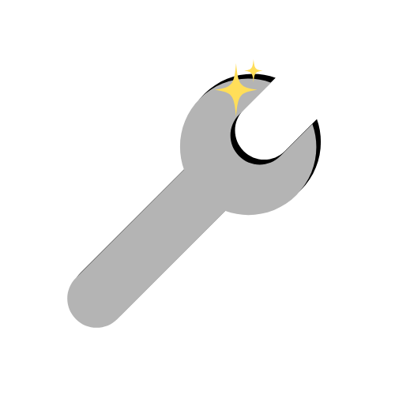
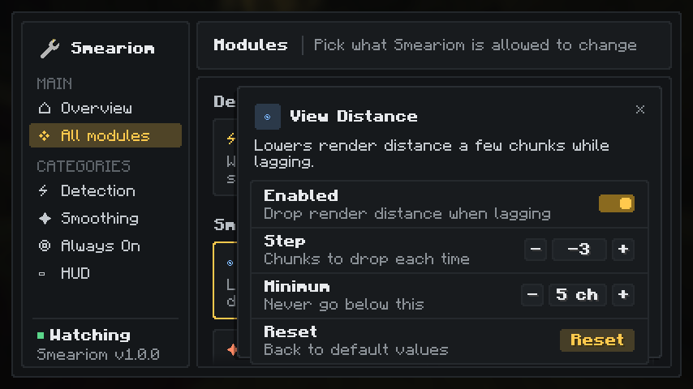
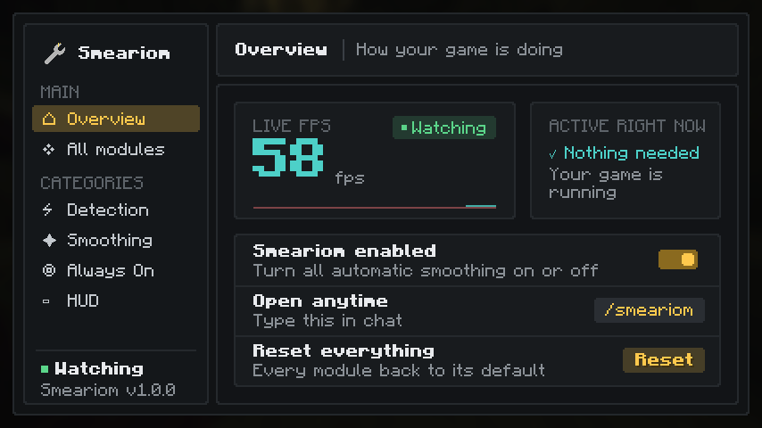
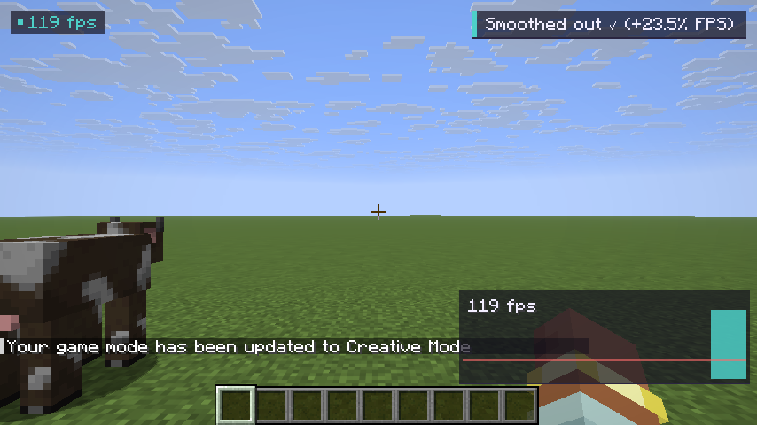

<h1 align="center">Smeariom</h1>

A Fabric mod that watches your FPS and smooths out lag automatically.

---

When your FPS drops, Smeariom looks at what's around you — big mob farms, piles of dropped items, mobs stuck in caves — and fixes that. It stops drawing them, lowers your view distance a little, and cuts down particles, clouds and shadows. Once your FPS is back to normal, it puts everything back the way it was.

Mobs close to you always stay visible, and your settings are always restored when you leave a world.

## Download

Grab the jar for your Minecraft version from the [**Releases**](../../releases) page:

| Minecraft | File |
|---|---|
| 26.2 | `smeariom-1.0.0+26.2.jar` |
| 1.21.11 | `smeariom-1.0.0+1.21.11.jar` |

You also need [Fabric Loader](https://fabricmc.net/use/) and [Fabric API](https://modrinth.com/mod/fabric-api). [Mod Menu](https://modrinth.com/mod/modmenu) is optional.

Client-side only, so it works on any server, vanilla included.

## Features

- Finds mob crowds, item piles and mobs hidden underground, and stops drawing them while you're lagging
- Temporarily lowers view distance and entity distance, and turns off clouds and shadows
- Thins out particles
- Optional always-on entity culling and particle limit
- FPS badge, FPS graph and status messages
- Puts every change back automatically once your FPS is steady

## Settings

Open them with **Mods → Smeariom** in the mod menu, or type `/smeariom` in chat.

## Bug reports

Found a problem? Open an [issue](../../issues) and include your `logs/latest.log` file.

## Credits

Based on Autoptimization by XLTQ, used under the MIT License. Rewritten with working entity hiding, safer threading and new features.
